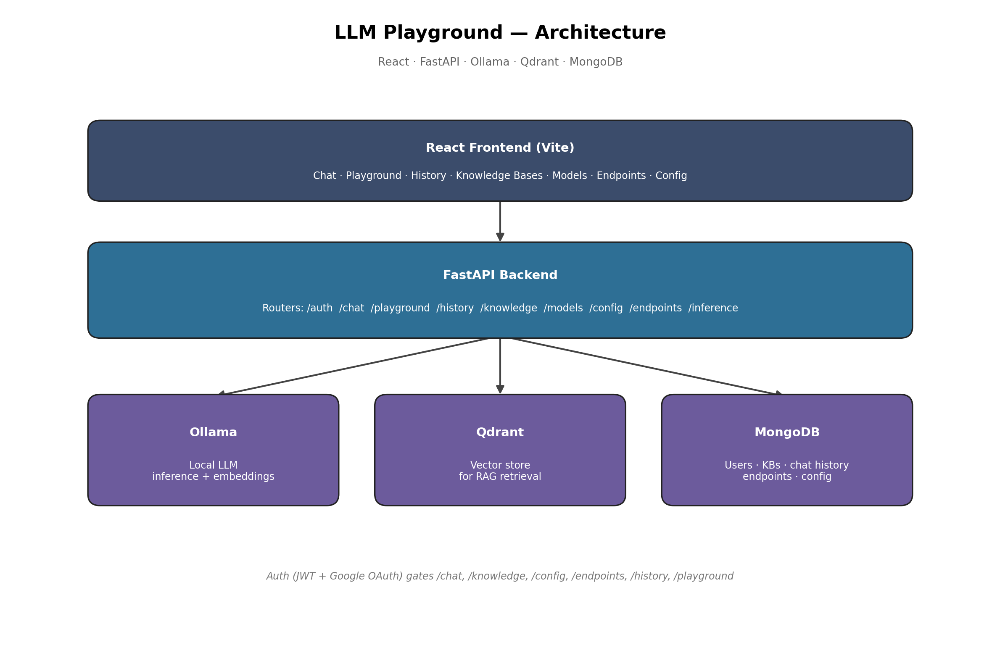

# LLM Playground

A local-first, full-stack platform for chatting with your own documents using a self-hosted LLM. Upload files, ask questions grounded in them with citations, tune hyperparameters, publish reusable inference endpoints, or just chat freely with any model in the built-in Playground — all running on your own machine, no cloud API keys required.

## Features

- **RAG chat** — upload PDFs, DOCX, TXT, CSV, or XLSX files into a knowledge base and ask questions with cited answers
- **Playground mode** — free-form chat with any local model, no knowledge base, nothing saved
- **Persistent chat history** — every RAG conversation is saved per user and browsable later
- **Model management** — list, pull, and delete local Ollama models (default models are protected from deletion)
- **Hyperparameter tuning** — global defaults, per-knowledge-base overrides, and per-request overrides
- **On-demand inference endpoints** — publish a `{knowledge base + hyperparameters}` combo as a reusable API endpoint
- **Auth** — email/password (JWT) and Google OAuth

## Tech stack

**Backend:** FastAPI, MongoDB, Qdrant, Ollama, Pydantic, Pytest, Docker
**Frontend:** React, Vite, axios

## Architecture



## Getting started

### Prerequisites
- Docker & Docker Compose
- [Ollama](https://ollama.com) installed locally
- Node.js 18+

### Run it

```bash
# 1. Pull the models the app needs
ollama pull llama3.2
ollama pull nomic-embed-text

# 2. Start Qdrant, MongoDB, and the backend
docker compose up -d --build

# 3. Start the frontend
cd frontend-react
npm install
npm run dev
```

Open `http://localhost:5173`, register an account (or sign in with Google, if configured), and start chatting.

### Configuration

Set these in `backend/.env`:
- `JWT_SECRET_KEY` — any random string
- `GOOGLE_CLIENT_ID` / `GOOGLE_CLIENT_SECRET` — optional, only needed for Google sign-in

## Project structure

```
llm-playground/
├── backend/          # FastAPI app (routers, services, schemas)
├── frontend-react/   # React (Vite) app
└── docker-compose.yml
```

## Tests

```bash
cd backend
pytest -v
```

## License

MIT
